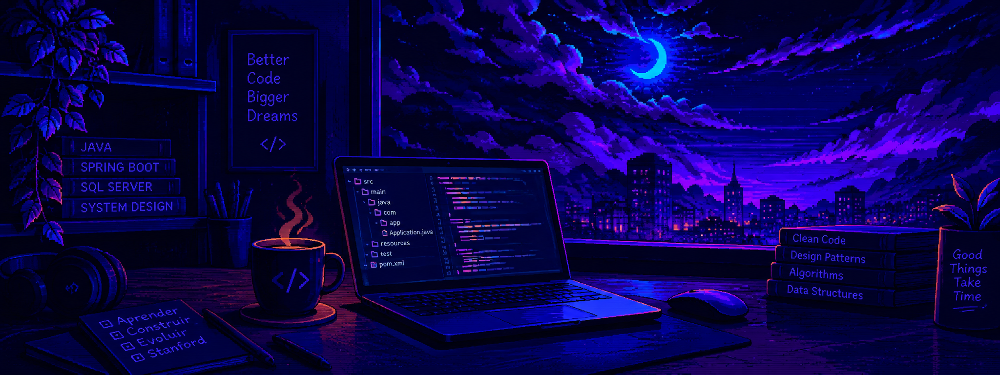

# 👨‍💻 Matheus Antônio

<!-- Replace this path with the banner image saved in your repository -->

  

  <b>Java Developer | Spring Boot | SQL Server | REST APIs</b>

---

## 👨‍🚀 About Me

Hi! I'm Matheus, a developer from Brazil passionate about technology, software development, and solving real-world problems through code.

- 🎓 Technical degree in Internet Application Development from SENAI.
- ☕ Focused on Java, Spring Boot, SQL Server, and REST APIs.
- 🚀 Building projects that combine technology and real-world impact.
- 🌱 Currently expanding my knowledge of Python, Data Science, and Artificial Intelligence.
- 🎯 Long-term goal: become an AI Engineer and build meaningful technology products.

> *"Great things are built one line of code at a time."*

## 🤝 Connect With Me

  
  &nbsp;&nbsp;
  
  &nbsp;&nbsp;
  

---

## 🛠️ My Tech Stack

  
  

**Also working with:** SQL Server, JSON, REST APIs, and API testing tools.

---

## 🚀 Featured Project

### 💙 Doe+ — Connecting Donors and NGOs

A social-impact project focused on connecting donors with non-governmental organizations (NGOs).

The project explores how technology can help make donations more accessible and strengthen connections between people and organizations that need support.

**Technologies:** Java · Spring Boot · SQL Server · REST APIs

🔗 [Explore the Doe+ repository](https://github.com/Tew10/DoePlus)

---

## 📊 GitHub Activity

  

  <a href="https://raw.githubusercontent.com/Tew10/Tew10/activity-assets/activity-30d.svg">30 dias</a> ·
  <a href="https://raw.githubusercontent.com/Tew10/Tew10/activity-assets/activity-90d.svg">90 dias</a> ·
  <a href="https://raw.githubusercontent.com/Tew10/Tew10/activity-assets/activity-365d.svg">365 dias</a>

  

---

## 📜 Certificates & Learning

A selection of courses and certifications related to my professional development.

<!-- Add certificate cards here as you complete courses.
     Include the course name, issuing institution, and certificate URL. -->

  
  
  

---

## 🌱 Currently Learning

- 🐍 Python and Data Analysis
- 📈 Statistics and Machine Learning
- 🤖 Artificial Intelligence and LLMs
- ☁️ Cloud Computing and AWS
- 🏗️ Software Architecture and Design Patterns

---

  <i>☕ Coffee, code, consistency, and a little bit of curiosity.</i>

  

